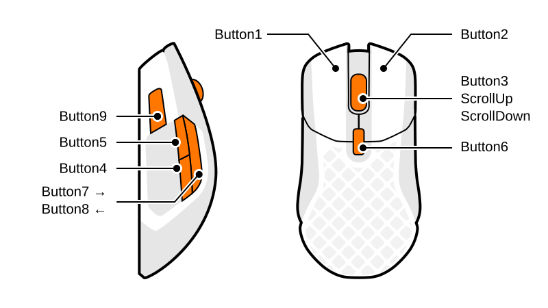

SteelSeries Aerox 5 Wireless
============================

Supported Models
----------------

.. rivalcfg_device_family:: aerox5_wireless_wired
.. rivalcfg_device_family:: aerox5_wireless_wireless

Command-Line Usage
------------------

.. rivalcfg_device_cli:: aerox5_wireless_wired

Sensitivity (DPI)
-----------------

This mouse supports up to 5 sensitivity presets. You can define them like this:

::

    rivalcfg --sensitivity 800       # one preset
    rivalcfg --sensitivity 800,1600  # two presets

You can switch preset using the button under the mouse wheel.

.. NOTE::

   When you set the sensitivity through the CLI, the selected preset always
   back to the first one.

.. NOTE:: From Python API, you can pass an ``int``, a ``tuple`` or a ``list``
   as parameter. You are also able to change the currently selected preset::

      mouse.sensitivity(800)
      mouse.sensitivity("800, 1600")
      mouse.sensitivity([800, 1600])
      # select the second preset (1600 dpi)
      mouse.sensitivity([800, 1600, 2000, 4000], selected_preset=2)

Colors
------

This mouse supports colors. Various formats are supported.

.. include:: ./_colors.rst

.. IMPORTANT::

   On newer SteelSeries mice, the color settings are not saved in the onboard
   memory anymore (see Default Lighting bellow).

Rainbow Effect
--------------

The Aerox 5 offers an onboard rainbow light effect. Please note that the effect
is reset if you change colors.

Default Lighting
----------------

.. include:: ./_default_lighting_reactive.rst

Brightness, Dimming and Smart Illumination
------------------------------------------

The brightness of the LEDs can be set from 0 to 15::

    rivalcfg --led-brightness 15

The LEDs are dimmed when the mouse stays idle. Both the delay (seconds, 0 to
disable) and the brightness of the dimmed LEDs (0 to 15, 0 turns them off) can
be set::

    rivalcfg --dim-timer 30
    rivalcfg --dim-brightness 1

The smart illumination turns the LEDs off while the mouse is moving to save
battery::

    rivalcfg --smart-illumination on
    rivalcfg --smart-illumination off

.. NOTE::

   These four settings are sent to the mouse in a single command. Rivalcfg
   cannot read them back from the mouse: when you change one of them, the
   others are set to the last value you defined with Rivalcfg (or to their
   default value).

Buttons
-------

.. include:: ./_buttons.rst

Python API
----------

TODO
